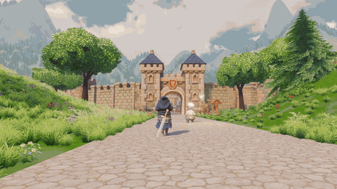

# Cozy Kingdom

溫馨奇幻風格的 3D 小遊戲實驗專案，使用 Godot 4.7（Forward+）。角色、建築、道具與草花貼圖大多由 AI 工具生成，地形和樹木則用 Blender 腳本程序化產生。



▶ [完整示範影片（70 秒，1600×900）](https://github.com/ammosu/cozy-kingdom-godot/releases/download/demo-v9/demo_v9_small.mp4)

## 內容

- 有城牆圍繞的王國：城門、市集、噴水池、主堡，城外是草原、森林和小屋
- 第三人稱與第一人稱鏡頭，可以騎麋鹿
- 和骷髏戰鬥：連擊、空中下劈、受擊反應與命中音效
- 跟隨玩家的小光靈，光影會照到周圍物件
- 大氣散射天空、體積雲、霧與雨天

## 執行

需要 [Godot 4.7](https://godotengine.org/)。

```bash
godot --path godot --windowed --resolution 1600x900
```

第一次開啟時 Godot 會匯入素材並編譯 shader，前面幾秒會比較卡。

## 操作

| 按鍵 | 動作 |
|---|---|
| WASD | 移動 |
| Shift | 跑 |
| Space | 跳 |
| 滑鼠左鍵 | 攻擊（空中是下劈；朝方向鍵方向出招） |
| 滾輪 | 縮放鏡頭，拉到最近再滾進第一人稱 |
| V | 切換第一人稱 |
| R | 騎上或離開麋鹿 |
| F | 切換天氣 |
| Esc | 放開滑鼠 |

## 相關文件

- [`TECH_STACK.md`](TECH_STACK.md)：用到的工具、AI 服務與內容製作方式
- [`CREDITS.md`](CREDITS.md)：第三方素材來源與授權
- [`NOTES.md`](NOTES.md)：各步驟的指令與開發筆記

## 授權注意

遊戲內的建築與道具是用 Hunyuan3D 2.1 Paint 上色的，這個模型限非商業用途，所以這些素材**不能直接商用**。第三方素材的授權請見 `CREDITS.md`。
